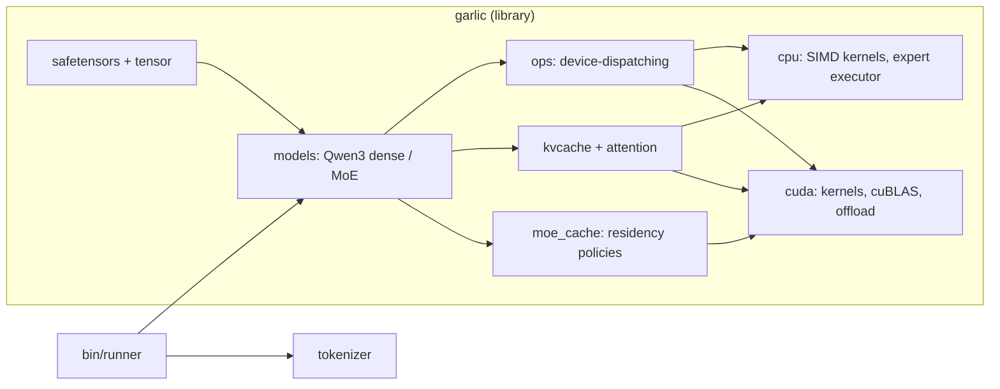
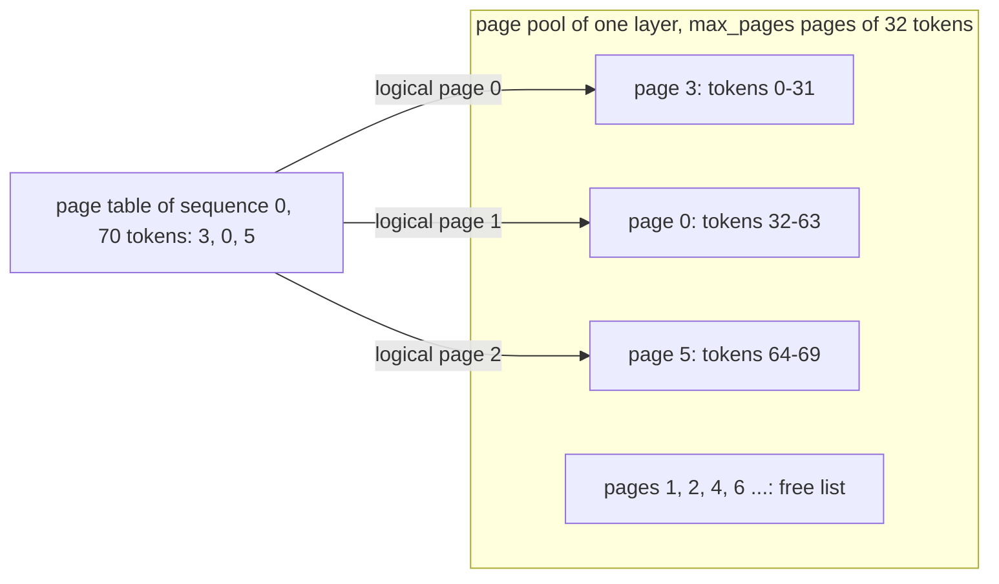
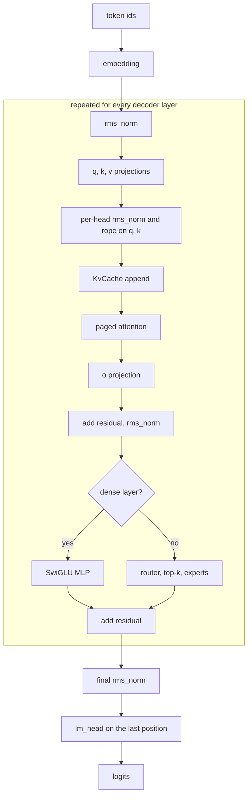
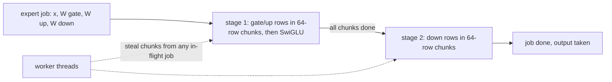
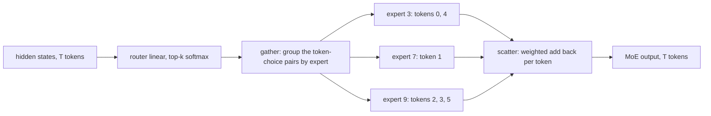
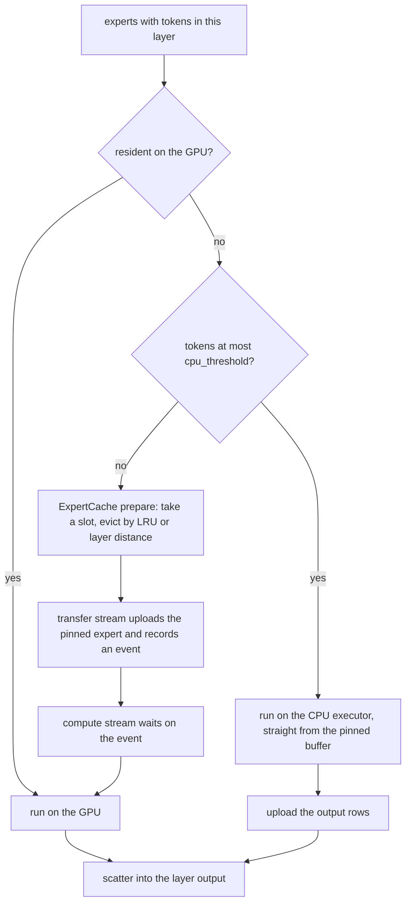
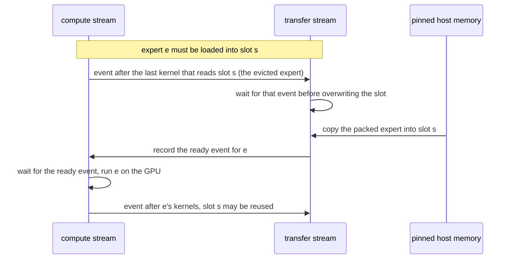
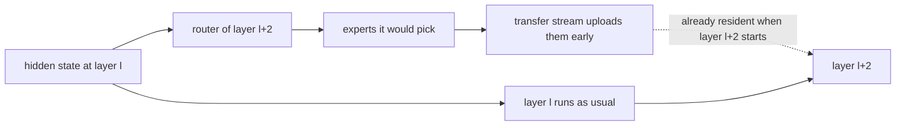
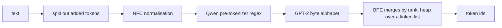

# Architecture

This is a map of how a token flows through the engine and where each piece
lives. Names in parentheses are the C++ garlic-inference counterparts.

## Overview



## Tensors and devices

`Tensor` (`Tensor` + `DataView`) is a shape, a dtype and a byte offset into
reference-counted storage. Cloning is shallow, and several tensors may view
one allocation. Storage is one of:

| storage | used for |
|---|---|
| `CpuBuffer::Owned` | activations, converted weights (64-byte aligned) |
| `CpuBuffer::Mapped` | weights straight out of the safetensors mmap |
| `CpuBuffer::Pinned` | offloaded experts (CUDA builds), readable by CPU kernels and uploadable asynchronously |
| `Storage::Cuda` | device memory, allocated stream-ordered on the compute stream |

FP8 weights carry a 2-D F32 block scale (`*_scale_inv`, normally one per
128x128 tile; `BlockLayout` works out the tiling from the scale shape).

On the CPU, activations are F32. On the GPU they are BF16 (F16 for F16
checkpoints) and the KV cache uses the same type.

## Concepts

**Paged KV cache.** Keys and values are stored in fixed pools of 32-token
pages (`[max_pages, kv_heads, 32, head_dim]` per layer) instead of one
contiguous buffer per sequence. A per-sequence page table maps token
positions to pages, and pages come from a free list as the sequence grows.
`--max-pages` sizes the pool and `--pages-per-seq` caps a sequence, so the
default of 128 pages allows 4096 tokens of context.



**Block-scaled FP8.** An FP8 (E4M3) weight is one byte per value plus a
scale for each 128x128 tile (`<name>_scale_inv`, an F32 matrix). A value is
`decode(byte) * scale`. Weights stay in FP8 in memory and are decoded inside
the matmul kernels, which halves the bytes streamed per token compared with
BF16. That is what bounds decode speed.

**Expert offloading.** A MoE layer has many experts (128 in Qwen3-30B-A3B)
but each token uses only a few. When all experts do not fit in GPU memory,
they live in pinned host memory and only a fixed number of device slots hold
copies. Experts that a batch needs are uploaded on demand, experts that got
only a few tokens run on the CPU instead of being uploaded, and the next
layers' likely experts are uploaded early. See "GPU expert offloading" below.

**Device dispatch.** Every op takes tensors and looks at where they live, so
the model code is the same for CPU and GPU. Moving a model to the GPU swaps
the weights' storage (`Qwen3::to_cuda`); nothing else changes.

## Using the library

```rust
use garlic::models::{self, LogitsMode};
use garlic::tokenizer::BpeTokenizer;
use garlic::{Tensor, ops};

let tokenizer = BpeTokenizer::load(dir)?;
let model = models::from_pretrained(dir)?;          // from_pretrained_on(dir, Device::Cuda) for the GPU
let mut caches = model.new_kv_caches(1, 64, 32);    // batch, pages in the pool, pages per sequence

let ids = tokenizer.encode("Hello");
let n = ids.len();
let positions: Vec<u32> = (0..n as u32).collect();
let logits = model.forward(
    &Tensor::from_u32(&ids, &[1, n])?,
    &Tensor::from_u32(&positions, &[1, n])?,
    &mut caches,
    LogitsMode::Last,                               // only the last position's logits
)?;
let next = ops::argmax_last(&logits)?[0];
```

Prefill passes the whole prompt in one call. Decoding then feeds one token at
a time with its absolute position; the caches remember everything before it.
`sampling::Sampler` replaces `argmax_last` when you want temperature, top-k,
top-p or a repetition penalty, and `StreamDecoder` turns tokens into text
without splitting multi-byte characters. `examples/generate.rs` is the full
loop and `src/bin/runner.rs` adds streaming, sampling and profiling.

## One forward pass

```
ids --embedding--> hidden [B,S,D]
for each decoder layer:
    residual = hidden
    h = rmsnorm(hidden)
    q,k,v = h Wq, h Wk, h Wv           per-head rmsnorm on q,k; rope on q,k
    KvCache::append(k, v)              pages mapped lazily from the free list
    o = PagedAttention(q, cache)       causal, GQA, online softmax
    h = o Wo
    residual += h; h = rmsnorm(residual)        (fused: add_rms_norm)
    h = MLP(h) | SparseMoe(h)
    hidden = h + residual
logits = rmsnorm(hidden[last]) W_lm   (LogitsMode::Last skips the other rows)
```



`ops::*` are free functions that dispatch on the tensor's device
(`linear`, `rms_norm`, ...), so `models/qwen3.rs` has a single code path.

## CPU kernels (`src/cpu`)

* `simd`: AVX-512 / AVX2+FMA / scalar, chosen once at runtime
  (`GARLIC_CPU_ISA` caps it).
* `linear`: `y = x W^T` split over rows of W. For up to 4 activation rows
  each weight row is decoded in registers and dotted against all of them
  (FP8 partial sums are scaled once per 128-wide group, like `fp8_gemv`).
  For more rows a task decodes its 16 weight rows once and runs a 4x4
  register-tiled microkernel.
* FP8 decode rebiases the exponent with an integer add. The classic "place
  the bits, multiply by 2^120" trick lets the compiler multiply before the
  subnormal lanes are masked, which costs ~100 cycles per denormal lane.
* `expert` (`fp8_expert_cpu`): one expert's SwiGLU FFN over T tokens plus a
  persistent executor. Each expert splits into 64-row chunks over two
  dependent stages (gate/up rows, then down rows); workers steal chunks
  across every in-flight expert, and submission is non-blocking.



The runner uses mimalloc: with glibc's allocator every op's output buffer
was returned to the kernel and page-faulted again, and parallel first-touch
faults serialise in the kernel.

## MoE

The router is a linear plus top-k softmax (`norm_topk_prob` renormalises
over the selected experts). `MoeRouting` lays the (token, choice) pairs out
contiguously per expert (`moe_gather`), each expert runs on its block, and
`scatter` adds the outputs back per token, weighted.



### GPU expert offloading (`src/cuda/moe.rs`, `src/moe_cache.rs`)

If the experts fit in VRAM they all stay resident. Otherwise
(`MoEManager`, `LRU_MoEManager`, `MRU_MoEManager`):

* each expert is packed gate|up|down into one pinned buffer, and its scales
  stay on the device;
* `ExpertCache` owns a fixed number of device slots and decides what to
  evict: LRU, or *layer distance* (evict the expert whose layer comes up
  last in the cyclic layer order, skipping protected layers);
* `CudaResidency` uploads on the transfer stream and records an event per
  expert. The compute stream waits on that event before using the slot, and
  the transfer stream waits for queued compute before overwriting an
  evicted slot;
* a layer loads its GPU experts in batches of at most half the pool, so a
  batch never evicts one of its own experts;
* **cold path**: an expert that is not resident and got at most
  `cpu_threshold` tokens runs on the CPU executor, straight from its pinned
  buffer with bf16 rounding that matches the GPU kernel. The result rows
  are uploaded while the GPU experts run;
* **prefetch**: during decode, layer `l` runs layer `l+2`'s router on its
  own hidden state and starts uploading the experts it picks.

How one layer decides where each of its experts runs:



Why the two streams cannot overwrite each other's data:



Speculative prefetch during decode:



## CUDA backend (`src/cuda`)

cudarc's raw driver API, with `libcuda`, `libnvrtc`, `libcublas` (and
`libnvidia-ml` for energy) loaded at runtime. `kernels.cu` is compiled with
NVRTC for the device's compute capability on first use and includes no CUDA
headers: bf16 and f16 are raw 16-bit values. Kernels are instantiated per
activation type (`*_bf16`, `*_f16`). Dense linears use cuBLAS GemmEx and FP8
linears a warp-per-row GEMV. Attention is a paged kernel (one block per
query row and head, four warps over the keys, merged in shared memory) that
replaces the cuDNN frontend SDPA graph. There are three streams: compute,
transfer (expert uploads) and secondary.

## Tokenizer

Byte-level BPE from `tokenizer.json`. Added tokens are split out first,
then NFC normalisation, then the Qwen pre-tokenizer regex (matched by hand
because `regex` has no lookahead), the GPT-2 byte alphabet, and merges by
rank on a heap over a linked symbol list. `StreamDecoder` buffers partial
UTF-8 while streaming.



## Verification

* `tests/model_parity.rs`: three tiny checkpoints against a float64 numpy
  transcription of `transformers`' Qwen3 / Qwen3-MoE code (dense with tied
  embeddings; MoE with a dense first layer; FP8 MoE with partial blocks).
* `tests/tokenizer_parity.rs`: 324 strings against HuggingFace
  `tokenizers`, using the exact Qwen pre-tokenizer configuration.
* `tests/cuda_parity.rs`: GPU vs CPU for each op, each model, and offloaded
  vs resident MoE. Needs a GPU.
* `cuda::tests::kernels_compile_for_all_archs`: NVRTC only, runs in CI.
