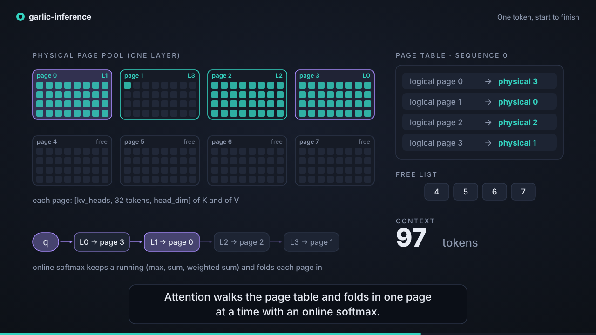
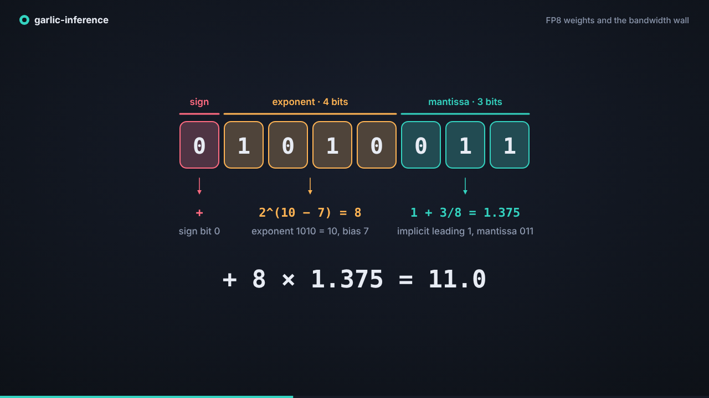
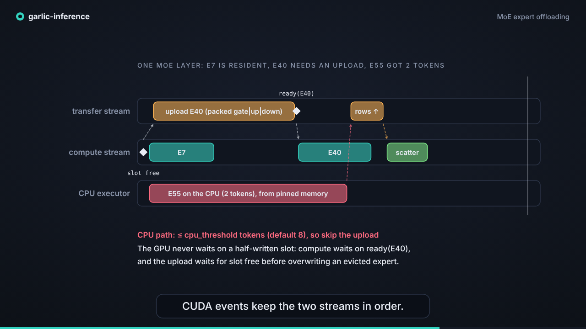

# Videos

Three short motion-graphics explainers (1280x720, 30 fps, silent with on-screen captions).
GitHub plays them on the file page: click a poster below.

| | | |
|---|---|---|
| [](forward-pass.mp4) | [](fp8-weights.mp4) | [](moe-offload.mp4) |
| **[One token, start to finish](forward-pass.mp4)** (50 s) | **[FP8 weights and the bandwidth wall](fp8-weights.mp4)** (52 s) | **[MoE expert offloading](moe-offload.mp4)** (58 s) |
| Tokenizer and embeddings, one decoder layer, the paged KV cache filling page by page, attention walking the page table, prefill versus the decode loop. | Why decoding is memory-bound, the FP8 E4M3 byte, 128x128 block scales, the fused decode-and-dot kernel, and the CPU numbers. | Top-k routing with gather and scatter, host memory versus GPU slots, LRU versus layer-distance eviction, the CPU cold path, CUDA events, and prefetch. |

Every number and name in them comes from this repository: the layer pipeline from
`src/models/qwen3.rs`, pages from `src/kvcache.rs`, the FP8 decode from `src/dtype.rs` and
`src/cpu/linear.rs`, the cache policies from `src/moe_cache.rs`, and the streams from
`src/cuda/moe.rs`. See [../ARCHITECTURE.md](../ARCHITECTURE.md) for the written version.
The token ids, expert numbers and routing weights on screen are illustrative, not captured
from a real run.

## How they are made

Each video is one HTML file in `src/` that draws an SVG as a pure function of time:
`render(t)` redraws the whole scene for second `t`. `render.cjs` steps `t` frame by frame,
screenshots each frame with headless Chromium (Playwright), and pipes the frames to ffmpeg.
There is no video editor involved, so a change to a scene is a code change.

```bash
cd docs/videos/src
npm install playwright                      # or use a global install and set NODE_PATH
node render.cjs forward-pass --poster 35.3  # writes ../forward-pass.mp4 and ../posters/forward-pass.png
node render.cjs fp8-weights  --poster 21.5
node render.cjs moe-offload  --poster 43.5
node render.cjs moe-offload  --still 31     # one frame to /tmp, for iterating on a scene
```

`CHROMIUM=/path/to/chrome` points Playwright at an existing browser, and ffmpeg needs
libx264. Opening any `src/*.html` in a browser plays the scene live; add `?t=12.5` to freeze it at
one moment. `src/lib.js` has the small drawing toolkit shared by the scenes.
